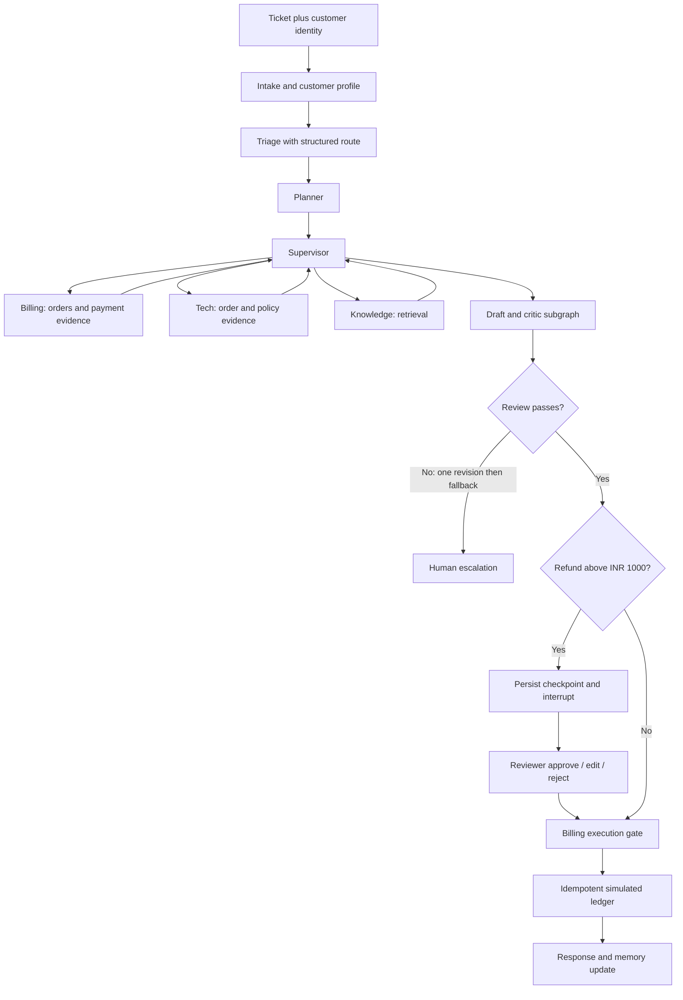

# RetailCare SupportDesk — five-hour multi-agent engineering workshop

Build one practical application across five hours: an e-commerce support desk that investigates a damaged product and a duplicate payment, coordinates specialist agents, remembers customer context, asks a human to approve a refund, and streams its progress through an API and browser console.

**Start here as the trainer:** complete [TRAINER_GUIDE.md](TRAINER_GUIDE.md), then open each hour's README. Every hourly README includes its exact TOC timing, the business scenario, workflow, library purposes, file explanations, numbered demonstration steps, sample input/output, and participant exercises. `Readme.me` is an identical convenience copy of each `README.md`, included to match the requested filename.

## The business case

Ananya (`C001`) ordered wireless headphones (`ORD1001`, INR 2,499). They arrived damaged two days ago. The payment CSV contains two captured payments of INR 2,499. Her request is:

> My headphones arrived damaged and I was charged twice. Please arrange a replacement and resolve the duplicate charge.

Billing must verify the duplicate, Tech Support must check damage policy, and a reviewer must approve refunds above INR 1,000. The system proposes replacement review, requests a damage photo and pickup preference, and records a **simulated** refund after approval. It never claims a replacement was shipped. All people, orders and policies are synthetic training data. This is an interactive implementation of a real business workflow, not a connection to a live retailer.

## What changes each hour

| Hour | TOC topic | Business capability added | Artifact |
|---|---|---|---|
| [1](hour_01_foundations/README.md) | Foundations of agents and MAS | Investigate the ticket with one agent, then split Billing and Tech Support | Two specialists with scoped tools |
| [2](hour_02_orchestration/README.md) | Orchestration and communication | Route single issues and supervise a ticket containing two issues | Sequential, router and supervisor graphs |
| [3](hour_03_memory_rag_mcp/README.md) | Memory, tools and knowledge | Remember the customer, retrieve policies and share order lookup over MCP | SQLite checkpoints, LangGraph Store, Chroma RAG, MCP |
| [4](hour_04_collaboration_reliability/README.md) | Collaboration, human review, reliability | Plan investigation, review the response, pause for approval, recover from failures | Review subgraph, interrupt/resume, retries and fallback |
| [5](hour_05_evaluation_deployment/README.md) | Evaluation, observability, deployment | Measure performance, enforce permissions, expose and demonstrate the service | 15-case evaluation, LangSmith, streaming FastAPI, Docker |

The source TOC allocates 12 minutes of theory and 48 minutes of practice per hour: 60 + 240 = 300 minutes. Installation, model access and downloading dependencies should be prepared before class. The eight-minute Hour-1 setup slot verifies the prepared environment; it is not enough for every participant to download a fresh environment on slow Wi-Fi.

## Two explicit execution modes

| Mode | What actually runs | Keys and expected output |
|---|---|---|
| `demo` | Real LangGraph, tools, CSV reads, MCP when requested, Chroma retrieval, checkpoints, interrupts and API; agent decisions and text are deterministic Python | No LLM key. Outputs are repeatable. This is a teaching simulation of agent reasoning, not an LLM benchmark. |
| `live` | Real LangChain `create_agent` model/tool loops; model-based triage, planner, supervisor and critic, with the same application-controlled business rules | Requires `OPENAI_API_KEY`. Wording, routing, timing and costs can vary. Refund amounts and execution permissions remain application-controlled. |

Demo embeddings use a documented `LocalHashEmbeddings` class: normalized hashed word counts, **not semantic embeddings**. Choose `EMBEDDING_BACKEND=openai` for paid semantic embeddings. The index is separated by backend/model. LangSmith tracing is optional in either mode; demo traces contain no model token usage.

## 1. Install and configure

Extract the **whole kit**. The hourly folders intentionally share `common/` and `data/`; do not copy just one folder. Use Python **3.12**, an editor, and a terminal. Docker is optional until Hour 5.

macOS/Linux, from the extracted kit directory:

```bash
python3.12 -m venv .venv
source .venv/bin/activate
python -m pip install -r requirements.txt
cp .env.example .env
python scripts/preflight.py
python scripts/smoke_test.py
```

Windows PowerShell, from the extracted kit directory:

```powershell
py -3.12 -m venv .venv
.\.venv\Scripts\Activate.ps1
python -m pip install -r requirements.txt
Copy-Item .env.example .env
python scripts/preflight.py
python scripts/smoke_test.py
```

If activation is restricted, invoke `.venv\Scripts\python.exe` directly instead of changing organizational execution policy. All later `python` commands work from the root directory of this kit on either OS. Use `curl.exe` instead of `curl` where PowerShell aliases it.

The five smoke checks should print `PASS`. The direct dependencies in `requirements.txt` are pinned to versions tested in this delivery. `requirements-lock.txt` captures the complete tested macOS Python-3.12 environment for reference; cross-platform installation should start with `requirements.txt`.

## 2. Run the hourly application

```bash
python hour_01_foundations/app.py --mode demo --pattern specialists
python hour_02_orchestration/app.py --mode demo --pattern supervisor
python hour_03_memory_rag_mcp/app.py --mode demo --thread memory-demo --mcp
python hour_04_collaboration_reliability/app.py --mode demo --thread approval-demo
python hour_04_collaboration_reliability/app.py --mode demo --thread approval-demo --decision approve
python hour_05_evaluation_deployment/app.py --mode demo --thread final-demo --stream
python hour_05_evaluation_deployment/app.py --mode demo --thread final-demo --decision approve
```

Hours 1–3 finish with `refund_status: proposed`. Hours 4–5 first return `status: awaiting_approval` and `refund_amount_inr: 2499`; approval returns `status: completed` and `refund_status: simulated`. Repeating an already recorded refund returns `already_simulated`, not a second ledger entry. A new thread gives fresh conversation state but intentionally retains that hour's customer profile and refund ledger.

Each hour includes `sample_input.json`, a captured `sample_output.json`, and `workflow.mmd`. Hours 4–5 also include `sample_output_approved.json`. See [VALIDATION.md](VALIDATION.md) for the exact scope of verification.

## 3. Switch to live agents and LangSmith

Edit the root `.env` file in your editor:

```dotenv
APP_MODE=live
OPENAI_API_KEY=your-provider-key
LLM_MODEL=gpt-4.1-mini
EMBEDDING_BACKEND=openai
EMBEDDING_MODEL=text-embedding-3-small
LANGSMITH_TRACING=true
LANGSMITH_API_KEY=your-langsmith-key
LANGSMITH_PROJECT=supportdesk-training
LANGSMITH_ENDPOINT=https://api.smith.langchain.com
```

Use a model enabled in your own account; the model name is configurable. To isolate generation costs first, keep `EMBEDDING_BACKEND=local_hash`. Use the LangSmith endpoint supplied for your workspace if it differs. Environment variables already set in the shell take precedence over `.env`. Restart the API after changing configuration.

```bash
python scripts/preflight.py
python hour_02_orchestration/app.py --mode live --thread live-h2
python hour_05_evaluation_deployment/app.py --mode live --thread live-h5
```

In LangSmith, open the `supportdesk-training` project and inspect the latest run. Expand triage, supervisor, billing/tech, tool calls and the review subgraph. Compare the tool input and its CSV observation with the agent's answer. Inspect model token counts and latency. `common/telemetry.py` also writes measured node-level data to `runtime/hour_N/metrics.jsonl`; configure your current token prices in `.env` to calculate a local estimate. Without rates, cost is `null`, not a fabricated zero. Local estimates exclude embeddings and external service charges; LangSmith displays model costs where supported.

API keys are neither included nor required for demo mode. Live model calls, semantic embeddings, CrewAI execution and cloud trace delivery must be rehearsed with your own credentials before class.

## 4. Show the application to participants

```bash
python -m uvicorn hour_05_evaluation_deployment.api:app --host 127.0.0.1 --port 8000 --workers 1
```

Open [the trainer console](http://127.0.0.1:8000) and [the API documentation](http://127.0.0.1:8000/docs). Submit the prefilled ticket. Point out the streamed graph updates, `awaiting_approval`, and the INR 2,499 proposal. Select Approve and click **Resume with decision**. Explain that the completed refund is simulated.

The console uses two classroom keys defined in `.env.example`: customer key for tickets and reviewer key for decisions. The customer key maps to `C001` by default; submitting another customer ID fails. The CLI is a trusted trainer interface and supports the other synthetic customers directly. This is a classroom authorization example, not an identity-management product.

## Application workflow



Agents communicate using `DeskState`: validated ticket fields, routes, pending/completed teams, evidence, draft, review and decision. The supervisor returns a LangGraph `Command` to hand control to the next specialist. Each live specialist has its own prompt and tool list; its internal model messages stay within its local agent invocation. Shared state receives findings, not hidden chain-of-thought. A response writer assembles those findings deterministically so participants can distinguish LLM reasoning from ordinary application code.

The Hour-4 review workflow is an actual compiled subgraph. Human review uses `interrupt()` and a later `Command(resume=...)` against the same namespaced thread. Execution happens after the approval node. The SQLite refund table has a unique order key, making repeated same-amount actions idempotent. Changed amounts after a prior refund are rejected for human investigation.

## Data and generated outputs

| File | Meaning and exercise |
|---|---|
| `data/customers.csv` | Synthetic customer directory; use to explain identity and assigned orders. Runtime preferences are learned from ticket input, not automatically seeded from this directory. |
| `data/orders.csv` | Ownership, product, amount, delivery status and fixed days since delivery. Change the damage window input to see eligibility change. |
| `data/payments.csv` | Captured payments. Identical extra captured payments constitute duplicates in this training contract. Remove a duplicate row and observe no eligible duplicate refund. |
| `data/knowledge.csv` | Six policy/manual chunks with source IDs, used by FAQ lookup and Chroma. Rebuild the demo state after editing/deleting documents. |
| `data/test_tickets.csv` | Fifteen inputs with expected routes, status and refund amount. This is evaluation ground truth, never model training input. |
| `runtime/hour_N/last_output.json` | Most recent run result; overwritten by the next run. |
| `runtime/hour_N/checkpoints.sqlite` | Durable thread state from Hour 3 onward. |
| `runtime/hour_N/profiles.json` | Snapshot backing the classroom LangGraph `InMemoryStore`; survives process restarts. |
| `runtime/hour_N/chroma_*` | Local retrieval index partitioned by embedding configuration. |
| `runtime/hour_N/refunds.sqlite` | Simulated refund ledger, created only when an action executes. |
| `runtime/hour_N/metrics.jsonl` | Per-node timings, token usage and optional estimated model cost. |
| `runtime/evaluation/results.csv`, `summary.json` | Evaluation results generated by the Hour-5 evaluation command. |

## File guide

| File/folder | Purpose |
|---|---|
| `hour_01_*` through `hour_05_*` | Incremental runnable labs; each README explains every local file. |
| `common/agents.py` | Agent prompts, scoped tools, structured LLM decisions and business nodes. Start here after reading an hourly graph. |
| `common/state.py` | Pydantic input/decision schemas and typed shared state. |
| `common/data.py` | CSV readers, ownership validation, payment calculation and transactional refund simulation. |
| `common/config.py` | Root-relative paths, `.env` loading and the configured chat model. |
| `common/knowledge.py` | Chroma setup, source metadata, retriever and two embedding choices. |
| `common/memory.py` | LangGraph Store with a JSON snapshot adapter for cross-process classroom memory. |
| `common/mcp_tools.py` | Real stdio MCP discovery and invocation with a 15-second timeout. |
| `common/telemetry.py` | Model callback usage collector and node timing log. |
| `common/runner.py` | Graph loading, checkpoint connections, namespaced threads, resume validation and failure fallback. |
| `common/cli.py` | Shared CLI options, input loading and JSON/event output. |
| `common/__init__.py` | Marks the shared Python package. |
| `scripts/preflight.py` | Checks imports and whether credentials are configured; never prints key values. |
| `scripts/smoke_test.py` | Runs all five hours against isolated temporary state. |
| `scripts/reset_demo.py` | Removes one hour's synthetic runtime artifacts for a repeatable demo. Stop its API before resetting. |
| `tests/test_workflow.py` | Business transitions, persisted memory, failure paths, approval and the 15-case contract. |
| `tests/test_api.py` | API authorization, streaming and approval checks. |
| `tests/test_mcp.py` | Launches the real MCP subprocess and verifies tool output. |
| `tests/test_live_contract.py` | Exercises real LangChain tool-loop mechanics with an offline test model. Does not verify a provider's responses. |
| `requirements.txt`, `requirements-lock.txt` | Tested direct versions and full environment reference respectively. |
| `.env.example` | Copyable configuration with no private credentials. |
| `.gitignore`, `.dockerignore` | Exclude secrets, environment files and runtime state from source/image copies. |
| `Dockerfile`, `compose.yaml` | Single-worker local container deployment with persisted runtime storage. |
| `TRAINER_GUIDE.md`, `DEPLOYMENT.md` | Rehearsal script, display checkpoints, service deployment and troubleshooting. |
| `TOC_COVERAGE.md`, `REFERENCES.md`, `VALIDATION.md` | Source-TOC mapping, official API references and honest test evidence. |
| `README.md`, `Readme.me` | This guide in standard Markdown and the requested filename. |

## Deployment, testing and scope

Follow [DEPLOYMENT.md](DEPLOYMENT.md) for local API, browser, curl, Docker, persistence checks and hosted-environment considerations. Run `python -m pytest -q` to execute the suite. The supplied implementation is intended for one trainer/local worker: durable JSON profile snapshots and SQLite are not a distributed multi-worker store. A hosted service needs managed identity, a durable shared database/store, secrets management and deployment-specific configuration.

The TOC's framework landscape and A2A are theory sections. CrewAI has a separate optional comparison script; AutoGen and OpenAI Agents SDK are comparison topics, not additional dependencies. A2A is explained in Hour 5 and is not falsely presented as implemented. The `langchain-mcp-adapters` integration is retained to match your TOC; the official documentation now also describes a newer MCP interface. See [REFERENCES.md](REFERENCES.md).
