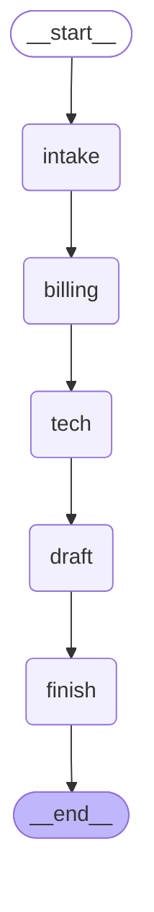

# Hour 1 — Foundations of Agents & Multi-Agent Systems

[Back to project README](../README.md) · [Trainer guide](../TRAINER_GUIDE.md) · [Deployment guide](../DEPLOYMENT.md)

## Use case and connection to this hour

RetailCare customer C001 reports damaged headphones and two charges for order ORD1001. The verified duplicate is INR 2,499. This hour adds **foundations of agents & multi-agent systems** to the same application; it does not switch to an unrelated example. The output is a proposal only; no action is executed in this hour.

## Hourly plan from the TOC

| Minutes | Topic/activity |
|---|---|
| 00–12 (12 min) | Theory: agents, roles, goals, messages, framework landscape |
| 12–20 (8 min) | Environment setup and LLM smoke check |
| 20–38 (18 min) | Single tool-using agent |
| 38–48 (10 min) | Observe limitations with nine tools |
| 48–60 (12 min) | Split Billing and Tech Support |

Total: **12 minutes theory + 48 minutes hands-on = 60 minutes**. Preinstall dependencies before the timed class.

## Concepts to explain

An agent combines a model, tools, memory and a control loop. In live mode, `create_agent` lets the model request a tool, receive its observation, and decide whether another action is needed. Show tool calls and observations; do not describe private model reasoning as an observable trace.

A single agent is suitable for a narrow task with a small tool set. Multiple agents can help when responsibilities, tool permissions or knowledge differ. Splitting every function into an agent adds unnecessary latency and cost. Here Billing needs payment evidence while Tech needs product policy; those are useful boundaries.

Framework landscape: LangGraph supplies explicit state/graph control; LangChain supplies the model/tool agent interface; CrewAI offers role/task orchestration; AutoGen and OpenAI Agents SDK are alternative agent frameworks discussed at a conceptual level. Only the frameworks needed for each lab are installed. In demo mode the control loop is scripted so it remains reproducible without keys.

## Workflow of this project stage



This diagram is exported from the default graph. For alternative Hour-1/2 patterns, inspect the matching branch in `graph.py`. Dotted Command destinations represent possible control transfers, not parallel execution. Shared business evidence is carried in `DeskState`; raw private model reasoning is not collected.

## Libraries used in this hour

| Library/tool | Why this hour uses it |
|---|---|
| langchain | `create_agent` live tool loop and tool definitions. |
| langchain-openai | Configured chat-model adapter for live calls. |
| langgraph | Build and run the single/specialist workflows. |
| python-dotenv | Load root `.env` without putting keys in source. |
| pydantic / typing-extensions | Validate ticket fields and define shared-state types. |
| langsmith | Optional traces inherited by model and tool calls; explored in Hour 5. |
| Python csv/json/pathlib | Read synthetic business data and write structured observations. |


## Files in this folder

| File in this folder | Explanation |
|---|---|
| `README.md` | This trainer/participant guide, rendered as Markdown. |
| `Readme.me` | Identical guide under the explicitly requested filename. |
| `__init__.py` | Marks this directory as an importable Python package. |
| `app.py` | Runnable CLI entry point; adds the kit root to the import path and selects this hour. |
| `failure_log_template.csv` | Blank observation worksheet for comparing single, overloaded and specialist runs. |
| `graph.py` | Graph wiring for this hour. Read nodes/edges here before inspecting shared node implementations. |
| `requirements.txt` | Includes the root tested dependency set; from this directory run `python -m pip install -r requirements.txt`. |
| `sample_input.json` | The mixed damaged-headphones / duplicate-charge ticket used in this hour. |
| `sample_output.json` | Captured deterministic demo output from a clean temporary runtime. |
| `smoke_llm.py` | Makes one real model call to verify provider connectivity; requires a key. |
| `workflow.mmd` | Mermaid graph generated from the compiled default workflow; open in a Mermaid-capable editor. |


### Shared files this hour uses

Core roles/tools: `common/agents.py`. CSV evidence and business rules: `common/data.py`. CLI and graph lifecycle: `common/cli.py` and `common/runner.py`. Model/env configuration: `common/config.py`. These files live at the kit root; their complete file guide is in [README.md](../README.md#file-guide). The source CSV files are in `data/`. Keep the full kit together.

## Step-by-step run and demonstration

**Working directory:** all commands below assume the kit root, with `.venv` activated as described in the root README. Alternatively, from this hourly folder run `python app.py` with the same flags. The application resolves shared data paths independently of your current directory.

### Step 1 — setup verification (8 minutes)

Follow the root README installation once. From the kit root run:

```bash
python scripts/preflight.py
```

For a prepared live account, run `python hour_01_foundations/smoke_llm.py` and show the one-sentence model reply plus reported usage. This command requires a provider key; skip it only for a declared demo-only class.

### Step 2 — build/inspect the single tool agent (18 minutes)

Open `graph.py` and `common/agents.py`. Find `create_agent` and the `single` tool list: order lookup plus FAQ search. Run:

```bash
python hour_01_foundations/app.py --mode demo --pattern single
```

Show `runtime/hour_1/tool_trace.json`: available tools, actual calls and observations. Demo makes scripted calls; for actual model selection run the same command with `--mode live`. Explain that order/FAQ evidence alone cannot verify duplicate payment records.

### Step 3 — observe tool overload (10 minutes)

```bash
python hour_01_foundations/app.py --mode demo --pattern overloaded
```

The trace now lists nine available tools. In live mode, inspect whether the model selects payment lookup for the mixed ticket. Fill `failure_log_template.csv` with observed calls, missing evidence and claims. If the live agent succeeds, record success; adding tools does not guarantee failure. This is an observation exercise, not a staged model-failure claim.

### Step 4 — split specialists (12 minutes)

```bash
python hour_01_foundations/app.py --mode demo --pattern specialists
```

Point out Billing's payment tool versus Tech's order/policy tools. In this hour both specialists run in a fixed sequence; dynamic triage is introduced next hour. Show the verified INR 2,499 proposal and the damage-photo request. No refund is executed yet.

### Participant change and check

Change the sample message to only a Bluetooth issue. Observe that the fixed sequence still runs Billing. Explain why Hour 2 needs routing. Restore the provided message before proceeding.

## Sample input

```json
{
  "customer_id": "C001",
  "order_id": "ORD1001",
  "message": "My headphones arrived damaged and I was charged twice. Please arrange a replacement and resolve the duplicate charge.",
  "preference": "email"
}
```

## Sample output to show participants

This excerpt is captured from the default **demo** pattern with clean synthetic state. See `sample_output.json` for the full result, event sequence and diagnostic fields. Actual thread IDs differ. Live text and model decisions may vary.

```json
{
  "hour": 1,
  "mode": "demo",
  "status": "completed",
  "route": [],
  "completed": [
    "billing",
    "tech"
  ],
  "refund_amount_inr": 2499,
  "refund_status": "proposed",
  "response": "Verified duplicate charge: INR 2499. Eligible for replacement review. Please provide a damage photo and pickup preference. Refund status: proposed; INR 2499. Saved contact preference: email.",
  "approval_request": []
}
```

The `completed` status means the investigation completed. `refund_status: proposed` explicitly means no refund was executed.

## Where to check the output

- Terminal JSON: current route, events and result. Add `--stream` to see graph updates.
- `runtime/hour_1/last_output.json`: most recent result from this hour.
- `runtime/hour_1/metrics.jsonl`: node measurements; no model tokens in demo mode.
- This hour uses in-memory checkpoints within one process; durable cross-process history starts in Hour 3.


For a clean rerun, stop any service using this hour, then run `python scripts/reset_demo.py --hour 1`. This deletes only generated synthetic runtime state. It does not modify source CSVs or captured sample outputs. The browser/API deployment is introduced in Hour 5; this hour's local deployment is its CLI command.

## Completion check

Participants should run the provided input, explain the stage's graph and tools, locate its output, and complete the small change above. Compare facts/statuses rather than requiring exact live wording. If a command fails, use [the troubleshooting table](../DEPLOYMENT.md#troubleshooting).
