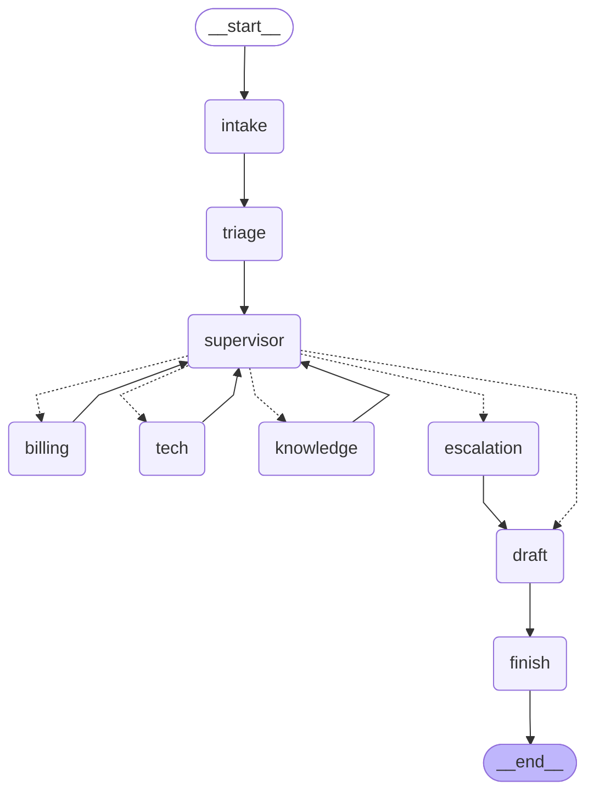

# Hour 2 — Orchestration Patterns & Agent Communication

[Back to project README](../README.md) · [Trainer guide](../TRAINER_GUIDE.md) · [Deployment guide](../DEPLOYMENT.md)

## Use case and connection to this hour

RetailCare customer C001 reports damaged headphones and two charges for order ORD1001. The verified duplicate is INR 2,499. This hour adds **orchestration patterns & agent communication** to the same application; it does not switch to an unrelated example. The output is a proposal only; no action is executed in this hour.

## Hourly plan from the TOC

| Minutes | Topic/activity |
|---|---|
| 00–12 (12 min) | Theory: sequential/router/supervisor/hierarchical/network patterns |
| 12–24 (12 min) | Typed shared state and sequential pipeline |
| 24–38 (14 min) | Router with conditional edges |
| 38–60 (22 min) | Supervisor delegation and handoffs |

Total: **12 minutes theory + 48 minutes hands-on = 60 minutes**. Preinstall dependencies before the timed class.

## Concepts to explain

Sequential pipelines run a fixed order and are easy to reason about. Routers select a branch from structured intent. Supervisors repeatedly delegate, inspect findings and select remaining work. A hierarchical pattern nests a specialist team under a supervisor; Hour 4's review subgraph makes this concrete. A network lets peers hand off directly, but uncontrolled cycles are harder to debug; Hour 4 demonstrates the failure.

`DeskState` is the shared work record. `pending` is remaining work, `completed` is a handoff history, and `findings` contains evidence. The supervisor returns `Command(goto=..., update=...)`: it updates state and transfers control together. Specialist internal model conversations are private to their invocation. Only their finding is shared. Our supervisor delegates sequentially so graph updates are easy to follow; this is not a parallel-performance demonstration.

## Workflow of this project stage



This diagram is exported from the default graph. For alternative Hour-1/2 patterns, inspect the matching branch in `graph.py`. Dotted Command destinations represent possible control transfers, not parallel execution. Shared business evidence is carried in `DeskState`; raw private model reasoning is not collected.

## Libraries used in this hour

| Library/tool | Why this hour uses it |
|---|---|
| langgraph | `StateGraph`, conditional edges, `Command` handoffs, START/END. |
| langchain / langchain-openai | Specialist model/tool agents and structured live routing. |
| pydantic / typing-extensions | Restrict team names and define `DeskState`. |
| langsmith | Trace supervisor and specialist transitions. |
| Python json | Inspect state and responses without a frontend. |


## Files in this folder

| File in this folder | Explanation |
|---|---|
| `README.md` | This trainer/participant guide, rendered as Markdown. |
| `Readme.me` | Identical guide under the explicitly requested filename. |
| `__init__.py` | Marks this directory as an importable Python package. |
| `app.py` | Runnable CLI entry point; adds the kit root to the import path and selects this hour. |
| `graph.py` | Graph wiring for this hour. Read nodes/edges here before inspecting shared node implementations. |
| `requirements.txt` | Includes the root tested dependency set; from this directory run `python -m pip install -r requirements.txt`. |
| `sample_input.json` | The mixed damaged-headphones / duplicate-charge ticket used in this hour. |
| `sample_output.json` | Captured deterministic demo output from a clean temporary runtime. |
| `workflow.mmd` | Mermaid graph generated from the compiled default workflow; open in a Mermaid-capable editor. |


### Shared files this hour uses

Shared contract: `common/state.py`. Triage, supervisor and specialists: `common/agents.py`. Graph lifecycle: `common/runner.py`. These files live at the kit root; their complete file guide is in [README.md](../README.md#file-guide). The source CSV files are in `data/`. Keep the full kit together.

## Step-by-step run and demonstration

**Working directory:** all commands below assume the kit root, with `.venv` activated as described in the root README. Alternatively, from this hourly folder run `python app.py` with the same flags. The application resolves shared data paths independently of your current directory.

### Step 1 — shared state and fixed pipeline (12 minutes)

Read `common/state.py`, then the `sequential` branch in this folder's `graph.py`.

```bash
python hour_02_orchestration/app.py --mode demo --pattern sequential
```

Show triage → Billing → Tech → draft → finish. The fixed sequence is an intentionally simple baseline and may do unnecessary work. The writer assembles specialist findings using ordinary code.

### Step 2 — one-pass router (14 minutes)

```bash
python hour_02_orchestration/app.py --mode demo --pattern router
```

Find `add_conditional_edges`. The route detects both issues, but this teaching router selects only the first specialist. Show `route: [billing, tech]` versus `completed: [billing]`; the response lacks replacement guidance. With a single-domain input it can be appropriate.

### Step 3 — supervisor and handoffs (22 minutes)

```bash
python hour_02_orchestration/app.py --mode demo --pattern supervisor --stream
```

Follow the `pending` queue as the supervisor delegates Billing, reviews the finding, then delegates Tech. Show both teams in `completed`. Open `Agents.supervisor` and explain `Command(goto=..., update=...)`. The live supervisor can choose which pending team to ask next; membership validation and a handoff budget constrain it.

Repeat with `--mode live` if credentials are configured; inspect model-based triage and the supervisor's structured selections in LangSmith. Do not promise identical ordering or wording from live models.

### Participant change and check

Create a copy of the sample JSON with `message: What is the delivery status of my order?`. Use `--input your_file.json`. Expect the Knowledge route in demo mode. Compare a router's one branch with the supervisor's mixed-issue loop.

## Sample input

```json
{
  "customer_id": "C001",
  "order_id": "ORD1001",
  "message": "My headphones arrived damaged and I was charged twice. Please arrange a replacement and resolve the duplicate charge.",
  "preference": "email"
}
```

## Sample output to show participants

This excerpt is captured from the default **demo** pattern with clean synthetic state. See `sample_output.json` for the full result, event sequence and diagnostic fields. Actual thread IDs differ. Live text and model decisions may vary.

```json
{
  "hour": 2,
  "mode": "demo",
  "status": "completed",
  "route": [
    "billing",
    "tech"
  ],
  "completed": [
    "billing",
    "tech"
  ],
  "refund_amount_inr": 2499,
  "refund_status": "proposed",
  "response": "Verified duplicate charge: INR 2499. Eligible for replacement review. Please provide a damage photo and pickup preference. Refund status: proposed; INR 2499. Saved contact preference: email.",
  "approval_request": []
}
```

The `completed` status means the investigation completed. `refund_status: proposed` explicitly means no refund was executed.

## Where to check the output

- Terminal JSON: current route, events and result. Add `--stream` to see graph updates.
- `runtime/hour_2/last_output.json`: most recent result from this hour.
- `runtime/hour_2/metrics.jsonl`: node measurements; no model tokens in demo mode.
- This hour uses in-memory checkpoints within one process; durable cross-process history starts in Hour 3.


For a clean rerun, stop any service using this hour, then run `python scripts/reset_demo.py --hour 2`. This deletes only generated synthetic runtime state. It does not modify source CSVs or captured sample outputs. The browser/API deployment is introduced in Hour 5; this hour's local deployment is its CLI command.

## Completion check

Participants should run the provided input, explain the stage's graph and tools, locate its output, and complete the small change above. Compare facts/statuses rather than requiring exact live wording. If a command fails, use [the troubleshooting table](../DEPLOYMENT.md#troubleshooting).
