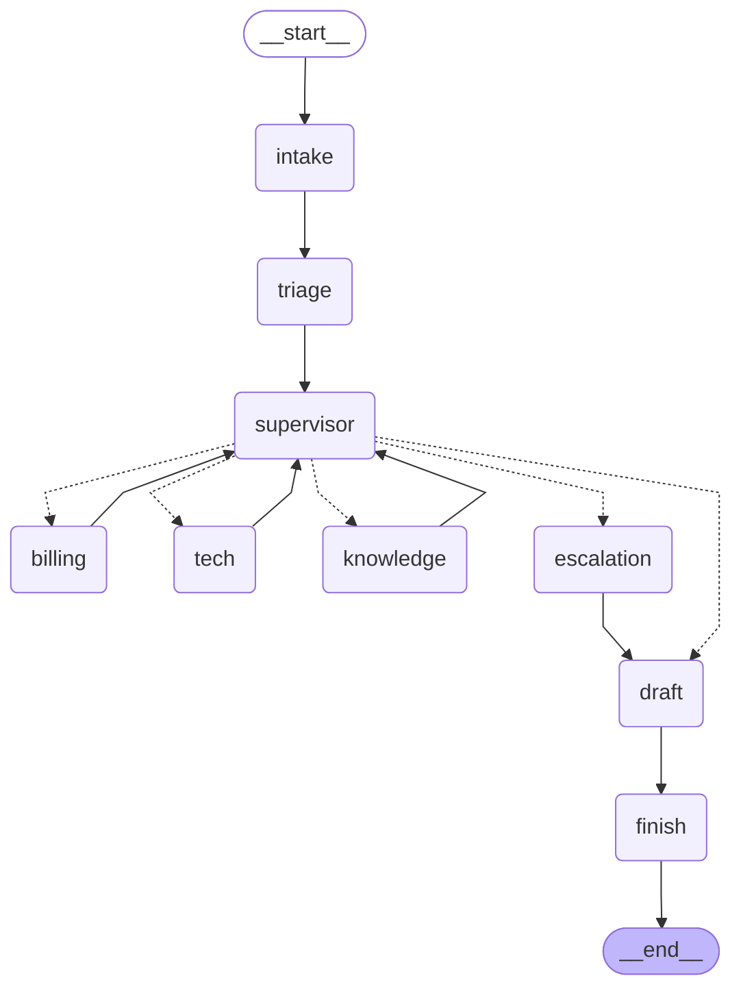

# Hour 3 — Memory, Tools & Knowledge Sharing

[Back to project README](../README.md) · [Trainer guide](../TRAINER_GUIDE.md) · [Deployment guide](../DEPLOYMENT.md)

## Use case and connection to this hour

RetailCare customer C001 reports damaged headphones and two charges for order ORD1001. The verified duplicate is INR 2,499. This hour adds **memory, tools & knowledge sharing** to the same application; it does not switch to an unrelated example. The output is a proposal only; no action is executed in this hour.

## Hourly plan from the TOC

| Minutes | Topic/activity |
|---|---|
| 00–12 (12 min) | Theory: thread memory, cross-session Store, RAG, MCP |
| 12–24 (12 min) | Conversation checkpointing |
| 24–34 (10 min) | Long-term customer profile |
| 34–48 (14 min) | Shared Knowledge agent and RAG |
| 48–60 (12 min) | Expose and consume MCP order lookup |

Total: **12 minutes theory + 48 minutes hands-on = 60 minutes**. Preinstall dependencies before the timed class.

## Concepts to explain

A checkpoint belongs to a thread: it lets the same conversation continue or resume. A Store is customer-scoped across threads: a new conversation can recover the saved contact preference and prior issue summary. Do not confuse the vector index with either memory mechanism.

This lab uses SQLite checkpoints and LangGraph `InMemoryStore` with a JSON snapshot adapter. The adapter restores and saves profiles across CLI process restarts; an ordinary `InMemoryStore` alone would lose them on restart. This adapter is designed for the single-worker class, not distributed production.

RAG retrieves relevant policy chunks when needed. Chroma stores vectors and source IDs; the response can cite the source. Live Billing/Tech receive an `ask_knowledge_agent` tool; the shared Knowledge agent has only a retrieval tool. Demo uses deterministic retrieval. MCP exposes order lookup through a separate stdio server process. MCP standardizes tool access; it does not decide which specialist should act.

## Workflow of this project stage



This diagram is exported from the default graph. For alternative Hour-1/2 patterns, inspect the matching branch in `graph.py`. Dotted Command destinations represent possible control transfers, not parallel execution. Shared business evidence is carried in `DeskState`; raw private model reasoning is not collected.

## Libraries used in this hour

| Library/tool | Why this hour uses it |
|---|---|
| langgraph-checkpoint-sqlite | Durable `SqliteSaver` checkpoints scoped by thread. |
| langgraph | Graph execution and customer-scoped `InMemoryStore` API. |
| langchain-chroma / chromadb | Persist vectors and retrieve policy/manual chunks. |
| langchain-core | `Document`, `Embeddings`, and retriever contracts. |
| langchain-openai | Optional semantic embeddings and live model calls. |
| mcp | `FastMCP` order tool server over stdio. |
| langchain-mcp-adapters | Discover and invoke the server via `MultiServerMCPClient`. |
| asyncio / sqlite3 / json | MCP timeout, checkpoint connection and profile snapshot persistence. |


## Files in this folder

| File in this folder | Explanation |
|---|---|
| `README.md` | This trainer/participant guide, rendered as Markdown. |
| `Readme.me` | Identical guide under the explicitly requested filename. |
| `__init__.py` | Marks this directory as an importable Python package. |
| `app.py` | Runnable CLI entry point; adds the kit root to the import path and selects this hour. |
| `followup_input.json` | Second policy question with no new preference, used for history and cross-session memory. |
| `graph.py` | Graph wiring for this hour. Read nodes/edges here before inspecting shared node implementations. |
| `knowledge_demo.py` | Prints retrieval backend and policy source IDs/text so retrieval can be demonstrated directly. |
| `mcp_demo.py` | Two consumers invoke the same real MCP order tool and print the results. |
| `mcp_server.py` | FastMCP stdio server exposing ownership-checked order lookup. |
| `requirements.txt` | Includes the root tested dependency set; from this directory run `python -m pip install -r requirements.txt`. |
| `sample_input.json` | The mixed damaged-headphones / duplicate-charge ticket used in this hour. |
| `sample_output.json` | Captured deterministic demo output from a clean temporary runtime. |
| `workflow.mmd` | Mermaid graph generated from the compiled default workflow; open in a Mermaid-capable editor. |


### Shared files this hour uses

Checkpoint lifecycle: `common/runner.py`. Customer Store adapter: `common/memory.py`. Retrieval: `common/knowledge.py`. MCP client: `common/mcp_tools.py`. Tool/Knowledge-agent integration: `common/agents.py`. These files live at the kit root; their complete file guide is in [README.md](../README.md#file-guide). The source CSV files are in `data/`. Keep the full kit together.

## Step-by-step run and demonstration

**Working directory:** all commands below assume the kit root, with `.venv` activated as described in the root README. Alternatively, from this hourly folder run `python app.py` with the same flags. The application resolves shared data paths independently of your current directory.

### Step 1 — same-thread conversation (12 minutes)

```bash
python hour_03_memory_rag_mcp/app.py --mode demo --thread customer-session-1
python hour_03_memory_rag_mcp/app.py --mode demo --thread customer-session-1 --input hour_03_memory_rag_mcp/followup_input.json
python hour_03_memory_rag_mcp/app.py --inspect --thread customer-session-1
```

Inspect the four history messages: two user turns and two assistant turns. Each command is a new Python process, so persistence is real. The follow-up fixture asks an explicit policy question; demo routing is keyword-based, not conversational inference. Live triage receives recent history. Ticket identity/order stay explicit rather than being inferred from ambiguous pronouns.

### Step 2 — cross-session memory (10 minutes)

```bash
python hour_03_memory_rag_mcp/app.py --mode demo --thread customer-session-2 --input hour_03_memory_rag_mcp/followup_input.json
```

The follow-up file omits a new preference, yet the result's `profile` includes `contact_preference: email`, `last_order` and `last_issues`. Inspect `profiles.json` and contrast it with the SQLite checkpoint. Customer C002 uses a separate Store namespace.

### Step 3 — retrieval and Knowledge agent (14 minutes)

```bash
python hour_03_memory_rag_mcp/knowledge_demo.py
```

Show the embedding backend and retrieved `doc_id`/text pairs. Open `data/knowledge.csv`, `common/knowledge.py` and `ask_knowledge_agent` in `common/agents.py`. Each CSV row is already a small document chunk. In live mode a specialist can call the Knowledge agent, which chooses retrieval through a restricted tool. In demo mode deterministic retrieval preserves the workflow without claiming model reasoning.

Optionally select `EMBEDDING_BACKEND=openai` in `.env` and rerun. Explain that local hashed vectors demonstrate plumbing; semantic embeddings improve meaning-based retrieval but require a provider call. Do not benchmark retrieval quality on six hand-selected training chunks.

### Step 4 — shared MCP order tool (12 minutes)

```bash
python hour_03_memory_rag_mcp/mcp_demo.py
python hour_03_memory_rag_mcp/app.py --mode demo --thread mcp-session --mcp
```

The first command prints two consumers (Billing and Tech). The second runs the graph with actual stdio MCP order calls. The adapter starts the server automatically; do not run the server manually in another terminal. In live mode the same bound order tool uses MCP. Each demo call opens a short-lived connection; production would usually reuse managed connections.

### Participant change and check

Change the preference to `chat`, complete a run, then use a new thread with an empty preference. Expect `chat`. Add a policy row with a unique `doc_id`, reset this hour's runtime, and inspect retrieval. Explain that resetting also removes profiles and history.

## Sample input

```json
{
  "customer_id": "C001",
  "order_id": "ORD1001",
  "message": "My headphones arrived damaged and I was charged twice. Please arrange a replacement and resolve the duplicate charge.",
  "preference": "email"
}
```

## Sample output to show participants

This excerpt is captured from the default **demo** pattern with clean synthetic state. See `sample_output.json` for the full result, event sequence and diagnostic fields. Actual thread IDs differ. Live text and model decisions may vary.

```json
{
  "hour": 3,
  "mode": "demo",
  "status": "completed",
  "route": [
    "billing",
    "tech"
  ],
  "completed": [
    "billing",
    "tech"
  ],
  "refund_amount_inr": 2499,
  "refund_status": "proposed",
  "response": "Verified duplicate charge: INR 2499. Eligible for replacement review. Please provide a damage photo and pickup preference. Refund status: proposed; INR 2499. Saved contact preference: email.",
  "approval_request": []
}
```

The `completed` status means the investigation completed. `refund_status: proposed` explicitly means no refund was executed.

## Where to check the output

- Terminal JSON: current route, events and result. Add `--stream` to see graph updates.
- `runtime/hour_3/last_output.json`: most recent result from this hour.
- `runtime/hour_3/metrics.jsonl`: node measurements; no model tokens in demo mode.
- `runtime/hour_3/checkpoints.sqlite` and `profiles.json`: thread state and cross-session profiles.


For a clean rerun, stop any service using this hour, then run `python scripts/reset_demo.py --hour 3`. This deletes only generated synthetic runtime state. It does not modify source CSVs or captured sample outputs. The browser/API deployment is introduced in Hour 5; this hour's local deployment is its CLI command.

## Completion check

Participants should run the provided input, explain the stage's graph and tools, locate its output, and complete the small change above. Compare facts/statuses rather than requiring exact live wording. If a command fails, use [the troubleshooting table](../DEPLOYMENT.md#troubleshooting).
