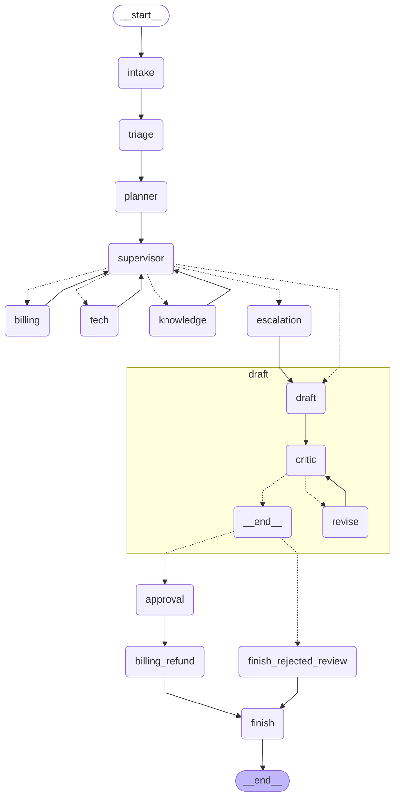

# Hour 4 — Collaboration, Human-in-the-Loop & Reliability

[Back to project README](../README.md) · [Trainer guide](../TRAINER_GUIDE.md) · [Deployment guide](../DEPLOYMENT.md)

## Use case and connection to this hour

RetailCare customer C001 reports damaged headphones and two charges for order ORD1001. The verified duplicate is INR 2,499. This hour adds **collaboration, human-in-the-loop & reliability** to the same application; it does not switch to an unrelated example. The graph pauses for approval above INR 1,000 before recording a simulated refund.

## Hourly plan from the TOC

| Minutes | Topic/activity |
|---|---|
| 00–12 (12 min) | Theory: planner/executor, critic, debate, interrupts, reliability |
| 12–28 (16 min) | Planner, executor team and critic subgraph |
| 28–42 (14 min) | Human approval / edit / rejection |
| 42–54 (12 min) | Loops, retries, timeout and fallback |
| 54–60 (6 min) | CrewAI comparison |

Total: **12 minutes theory + 48 minutes hands-on = 60 minutes**. Preinstall dependencies before the timed class.

## Concepts to explain

The planner orders required work, the executor team investigates, and the critic checks the draft against evidence. A failed review gets one revision; if the second check fails, the graph escalates. The review workflow is a real LangGraph subgraph. Debate means collecting differing proposals and resolving their disagreement; it is discussed here but intentionally not added as another expensive loop to this five-hour application.

Human-in-the-loop control is a state transition: `interrupt()` pauses with a proposal, the checkpoint persists, and `Command(resume=decision)` continues later. The interrupted node starts again on resume. Therefore the application places the ledger write in the following Billing execution node.

Reliability has several layers: bounded graph steps, a handoff budget, three read-only node attempts, bounded provider/MCP calls and a fallback outcome. Idempotency prevents repeated same-order refunds. A reviewer can approve, reduce the proposed amount, or reject. The application validates the amount independently of the model.

## Workflow of this project stage



This diagram is exported from the default graph. For alternative Hour-1/2 patterns, inspect the matching branch in `graph.py`. Dotted Command destinations represent possible control transfers, not parallel execution. Shared business evidence is carried in `DeskState`; raw private model reasoning is not collected.

## Libraries used in this hour

| Library/tool | Why this hour uses it |
|---|---|
| langgraph | Subgraphs, `interrupt`, `Command`, `RetryPolicy` and recursion limits. |
| langgraph-checkpoint-sqlite | Resume approvals after the CLI process exits. |
| langchain / langchain-openai | Live planning, specialist investigation and structured critique. |
| pydantic | Validate approve/reject/edit payloads and edited amounts. |
| sqlite3 | Transactional simulated refund ledger with a unique order key. |
| crewai (separate optional environment) | Compare role/task-driven triage and Billing with graph orchestration. |
| langsmith | Inspect retries, interruptions and nested review runs. |


## Files in this folder

| File in this folder | Explanation |
|---|---|
| `README.md` | This trainer/participant guide, rendered as Markdown. |
| `Readme.me` | Identical guide under the explicitly requested filename. |
| `__init__.py` | Marks this directory as an importable Python package. |
| `app.py` | Runnable CLI entry point; adds the kit root to the import path and selects this hour. |
| `crewai_comparison.py` | Optional live triage/Billing crew using read-only CSV evidence. |
| `graph.py` | Graph wiring for this hour. Read nodes/edges here before inspecting shared node implementations. |
| `reliability_demo.py` | Deliberate Billing/Tech handoff loop followed by a bounded escalation fix. |
| `requirements-crewai.txt` | Separate environment dependencies for the optional CrewAI comparison. |
| `requirements.txt` | Includes the root tested dependency set; from this directory run `python -m pip install -r requirements.txt`. |
| `sample_input.json` | The mixed damaged-headphones / duplicate-charge ticket used in this hour. |
| `sample_output.json` | Captured deterministic demo output from a clean temporary runtime. |
| `sample_output_approved.json` | Captured result after approving the above-threshold refund on the same thread. |
| `small_refund_input.json` | C002/ORD1002 duplicate charge of INR 499, below the approval threshold. |
| `workflow.mmd` | Mermaid graph generated from the compiled default workflow; open in a Mermaid-capable editor. |


### Shared files this hour uses

Planner/critic/approval nodes: `common/agents.py`. Idempotent action boundary: `common/data.py`. Resume validation and exception fallback: `common/runner.py`. Decision schema: `common/state.py`. These files live at the kit root; their complete file guide is in [README.md](../README.md#file-guide). The source CSV files are in `data/`. Keep the full kit together.

## Step-by-step run and demonstration

**Working directory:** all commands below assume the kit root, with `.venv` activated as described in the root README. Alternatively, from this hourly folder run `python app.py` with the same flags. The application resolves shared data paths independently of your current directory.

### Step 1 — planner and critic (16 minutes)

Open `graph.py`. Identify the parent graph and the compiled draft → critic → optional revision subgraph. Run the sample ticket:

```bash
python hour_04_collaboration_reliability/app.py --mode demo --thread review-1 --stream
```

Show the `plan`, specialist evidence, passing `review`, and final pause. Live mode uses structured model planning and critique; demo checks route coverage and draft presence. The deterministic revision removes speculative agent wording by rebuilding from trusted business summaries.

### Step 2 — human approval, editing and rejection (14 minutes)

First inspect the checkpoint and then resume it:

```bash
python hour_04_collaboration_reliability/app.py --inspect --thread review-1
python hour_04_collaboration_reliability/app.py --mode demo --thread review-1 --decision approve
```

Expected: `refund_status: simulated`, amount INR 2,499. Both invocations are separate processes. No model can approve itself: the CLI reviewer decision is a trusted trainer action; Hour 5 separates customer/reviewer API keys.

To demonstrate rejection, submit a fresh thread and reject its proposal:

```bash
python hour_04_collaboration_reliability/app.py --mode demo --thread reject-1
python hour_04_collaboration_reliability/app.py --mode demo --thread reject-1 --decision reject
```

Expected: `refund_status: rejected`. An earlier simulated refund is not undone; reset synthetic state before demonstrating a different amount. Stop any app for this hour, then:

```bash
python scripts/reset_demo.py --hour 4
python hour_04_collaboration_reliability/app.py --mode demo --thread edit-1
python hour_04_collaboration_reliability/app.py --mode demo --thread edit-1 --decision edit --amount 2000
```

Expected: a simulated INR 2,000 refund. An edit of INR 9,999 fails input validation. Show the smaller automatic-threshold example:

```bash
python hour_04_collaboration_reliability/app.py --mode demo --thread small-1 --input hour_04_collaboration_reliability/small_refund_input.json
```

Expected: INR 499, completed without a human interrupt.

### Step 3 — failure injection and recovery (12 minutes)

```bash
python hour_04_collaboration_reliability/reliability_demo.py
python hour_04_collaboration_reliability/app.py --mode demo --thread retry-1 --fault once
python hour_04_collaboration_reliability/app.py --mode demo --thread outage-1 --fault always
```

The loop script first catches `GraphRecursionError`, then exits through escalation after four handoffs. `--fault once` fails the first Billing read and succeeds on retry; it reaches approval. `--fault always` exhausts three attempts and returns `escalated` / `not_executed`. Use a fresh thread after this deliberate failure; its checkpoint remains available for inspection.

Read-only nodes use `RetryPolicy`. Provider calls have a 25-second request timeout with one provider retry; MCP calls have a 15-second timeout. These are per-call limits, not an end-to-end SLA. Side effects are not retried blindly; the unique ledger key handles repeat delivery.

### Step 4 — CrewAI comparison (6 minutes)

Prepare this separate environment before class. macOS/Linux:

```bash
python3.12 -m venv .venv-crewai
.venv-crewai/bin/python -m pip install -r hour_04_collaboration_reliability/requirements-crewai.txt
.venv-crewai/bin/python hour_04_collaboration_reliability/crewai_comparison.py
```

On Windows use `py -3.12 -m venv .venv-crewai`, then `.venv-crewai\Scripts\python.exe` for both commands. This optional script needs a real provider key and runs two sequential tasks with a read-only payment tool. Expected semantic result: Billing verifies the duplicate INR 2,499 charge and requests reviewer approval. Exact prose is not fixed.

Compare CrewAI's Agent/Task/Crew definitions with explicit LangGraph nodes, edges and durable interrupts. The comparison is only triage + Billing; do not imply it implements the full support application. LangSmith wiring in this kit targets the LangChain/LangGraph app, not the CrewAI comparison.

### Participant change and check

Use `--recursion-limit 5` on a new thread and observe bounded failure. Locate the hardcoded training threshold in both the approval gate and backend validation; explain why changing only a prompt must not change authorization.

## Sample input

```json
{
  "customer_id": "C001",
  "order_id": "ORD1001",
  "message": "My headphones arrived damaged and I was charged twice. Please arrange a replacement and resolve the duplicate charge.",
  "preference": "email"
}
```

## Sample output to show participants

This excerpt is captured from the default **demo** pattern with clean synthetic state. See `sample_output.json` for the full result, event sequence and diagnostic fields. Actual thread IDs differ. Live text and model decisions may vary.

```json
{
  "hour": 4,
  "mode": "demo",
  "status": "awaiting_approval",
  "route": [
    "billing",
    "tech"
  ],
  "completed": [
    "billing",
    "tech"
  ],
  "refund_amount_inr": 2499,
  "refund_status": "proposed",
  "response": "",
  "approval_request": [
    {
      "kind": "refund_approval",
      "order_id": "ORD1001",
      "amount_inr": 2499,
      "threshold_inr": 1000,
      "message": "Approve, reject, or edit this SIMULATED refund."
    }
  ]
}
```

After approval, compare `sample_output_approved.json`: expect `status: completed` and `refund_status: simulated`. A previously recorded same-order refund returns `already_simulated` instead. The initial paused result has a draft and approval request; an empty final `response` is expected until it resumes.

## Where to check the output

- Terminal JSON: current route, events and result. Add `--stream` to see graph updates.
- `runtime/hour_4/last_output.json`: most recent result from this hour.
- `runtime/hour_4/metrics.jsonl`: node measurements; no model tokens in demo mode.
- `runtime/hour_4/checkpoints.sqlite` and `profiles.json`: thread state and cross-session profiles.
- `runtime/hour_4/refunds.sqlite`: the simulated action ledger after an approved/automatic action.

For a clean rerun, stop any service using this hour, then run `python scripts/reset_demo.py --hour 4`. This deletes only generated synthetic runtime state. It does not modify source CSVs or captured sample outputs. The browser/API deployment is introduced in Hour 5; this hour's local deployment is its CLI command.

## Completion check

Participants should run the provided input, explain the stage's graph and tools, locate its output, and complete the small change above. Compare facts/statuses rather than requiring exact live wording. If a command fails, use [the troubleshooting table](../DEPLOYMENT.md#troubleshooting).
