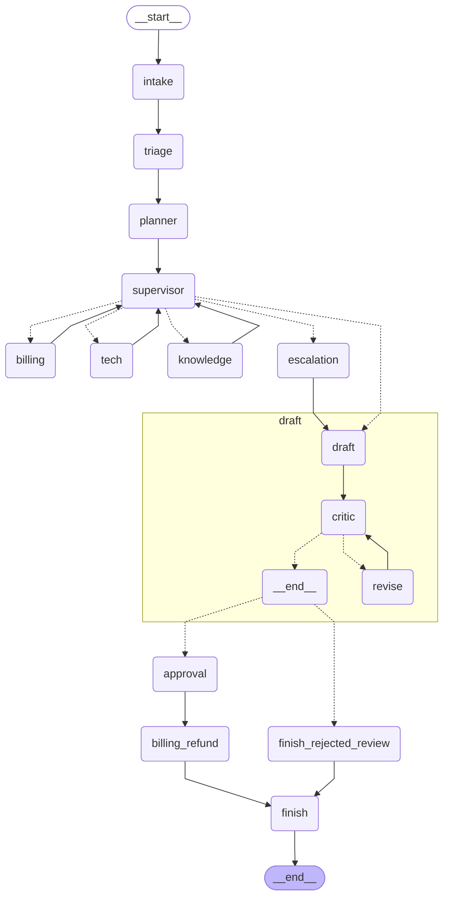

# Hour 5 — Evaluation, Observability & Deployment of MAS

[Back to project README](../README.md) · [Trainer guide](../TRAINER_GUIDE.md) · [Deployment guide](../DEPLOYMENT.md)

## Use case and connection to this hour

RetailCare customer C001 reports damaged headphones and two charges for order ORD1001. The verified duplicate is INR 2,499. This hour adds **evaluation, observability & deployment of mas** to the same application; it does not switch to an unrelated example. The graph pauses for approval above INR 1,000 before recording a simulated refund.

## Hourly plan from the TOC

| Minutes | Topic/activity |
|---|---|
| 00–12 (12 min) | Theory: evaluation, tracing, security, deployment and A2A |
| 12–22 (10 min) | Trace timing and token cost per agent |
| 22–36 (14 min) | Evaluate 15 tickets and optional model judge |
| 36–46 (10 min) | Prompt-injection examples and permissions |
| 46–60 (14 min) | Deploy API/container and show streaming output |

Total: **12 minutes theory + 48 minutes hands-on = 60 minutes**. Preinstall dependencies before the timed class.

## Concepts to explain

Evaluate more than fluent text: routing correctness asks whether the right teams were selected; handoff correctness asks whether those teams actually completed; task success also checks the expected status and refund amount. A model judge provides a separate subjective quality score, not evidence that authorization rules are safe.

Tracing reveals where time and tokens were spent, including nested agent/tool calls. LangSmith receives framework traces when configured; local JSONL metrics are also available. Demo token counts are zero because it makes no model calls.

Untrusted instructions can arrive from a ticket, retrieved document or another agent. Pattern filters demonstrate a few attacks; actual action boundaries also enforce identity, tool scope, refund limits and reviewer credentials. Do not claim pattern matching solves prompt injection.

MCP and A2A solve different integration problems. MCP exposes tools/context to an agent. A2A addresses communication with independently hosted agents using discovery, tasks/messages and results. The A2A part of the TOC is an overview, not an implemented transport in this kit. Our service is an HTTP API with graph-update SSE streaming.

## Workflow of this project stage



This diagram is exported from the default graph. For alternative Hour-1/2 patterns, inspect the matching branch in `graph.py`. Dotted Command destinations represent possible control transfers, not parallel execution. Shared business evidence is carried in `DeskState`; raw private model reasoning is not collected.

## Libraries used in this hour

| Library/tool | Why this hour uses it |
|---|---|
| langsmith | Trace runs and optionally create a dataset/experiment with evaluators. |
| pytest | Test business behavior, persistence, API and MCP paths. |
| fastapi / pydantic | Typed HTTP endpoints, validation and separate customer/reviewer headers. |
| uvicorn | Serve FastAPI locally and inside Docker with one worker. |
| httpx | FastAPI test client transport and HTTP verification. |
| langgraph / LangChain stack | The cumulative graph, streaming updates and live agents. |
| Python csv/json/queue/threading | Evaluation reports, local telemetry and streamed worker events. |
| Docker / Compose (external tools) | Package and run the single-worker service with a persistent named volume. |


## Files in this folder

| File in this folder | Explanation |
|---|---|
| `README.md` | This trainer/participant guide, rendered as Markdown. |
| `Readme.me` | Identical guide under the explicitly requested filename. |
| `__init__.py` | Marks this directory as an importable Python package. |
| `api.py` | FastAPI service with ticket, SSE stream, approval, health, thread-inspection and console routes. |
| `app.py` | Runnable CLI entry point; adds the kit root to the import path and selects this hour. |
| `demo.html` | Browser trainer console that submits tickets, displays streamed events and resumes human decisions. |
| `evaluate.py` | Runs the test CSV, writes scores, and optionally uses a model judge/LangSmith experiment. |
| `evaluation_sample.csv` | Captured per-case demo evaluation results for classroom comparison. |
| `evaluation_summary.json` | Captured aggregate demo scores; live evaluation may differ. |
| `graph.py` | Graph wiring for this hour. Read nodes/edges here before inspecting shared node implementations. |
| `injection_input.json` | Explicit attack example for the Hour-5 input guard demonstration. |
| `metrics_report.py` | Summarizes node latency, measured model tokens and configured-rate cost estimates. |
| `permission_demo.py` | Shows that incorrect tool role and missing above-threshold approval are rejected. |
| `requirements.txt` | Includes the root tested dependency set; from this directory run `python -m pip install -r requirements.txt`. |
| `sample_input.json` | The mixed damaged-headphones / duplicate-charge ticket used in this hour. |
| `sample_output.json` | Captured deterministic demo output from a clean temporary runtime. |
| `sample_output_approved.json` | Captured result after approving the above-threshold refund on the same thread. |
| `workflow.mmd` | Mermaid graph generated from the compiled default workflow; open in a Mermaid-capable editor. |


### Shared files this hour uses

Local usage and latency collection: `common/telemetry.py`. Graph lifecycle/output contract: `common/runner.py`. Guards and tool scopes: `common/agents.py` and `common/data.py`. Root `Dockerfile`/`compose.yaml` package the service. These files live at the kit root; their complete file guide is in [README.md](../README.md#file-guide). The source CSV files are in `data/`. Keep the full kit together.

## Step-by-step run and demonstration

**Working directory:** all commands below assume the kit root, with `.venv` activated as described in the root README. Alternatively, from this hourly folder run `python app.py` with the same flags. The application resolves shared data paths independently of your current directory.

### Step 1 — tracing and per-agent measurements (10 minutes)

Configure LangSmith as shown in the root README. For a deterministic trace, keep demo mode; for model tokens use live mode with your provider key.

```bash
python hour_05_evaluation_deployment/app.py --mode demo --thread trace-1
python hour_05_evaluation_deployment/metrics_report.py runtime/hour_5/metrics.jsonl
```

Open the LangSmith project and inspect agent/tool child runs. Sort local aggregate results by elapsed time and identify expensive nodes. Token counts in demo are zero. Local specialist token totals include their nested Knowledge-agent calls; LangSmith exposes the nested calls individually. Price estimates require current rates in `.env` and exclude embeddings; do not add overlapping parent/child timing spans as an end-to-end duration.

### Step 2 — evaluation (14 minutes)

```bash
python hour_05_evaluation_deployment/evaluate.py --mode demo
python -m pytest -q
```

Open `runtime/evaluation/results.csv` and `summary.json`. The supplied demo fixtures should report 15 tickets and 1.0 for routing, handoff correctness and task success. These are fixture checks, not proof of general LLM accuracy. The evaluation uses isolated temporary checkpoints and ledger state; it does not change the trainer's active tickets.

With credentials, run a separate live evaluation and optional quality judge:

```bash
python hour_05_evaluation_deployment/evaluate.py --mode live --judge
```

The judge returns a 1–5 quality score and explanation per response; without `--judge` those fields say it was not run. It is not part of the deterministic success score. Optionally upload only these synthetic cases and run a cloud experiment:

```bash
python hour_05_evaluation_deployment/evaluate.py --mode live --langsmith
```

This creates a uniquely named dataset/experiment in your LangSmith account and incurs provider calls in live mode. It requires both relevant credentials. Review individual failures, not just the aggregate score.

### Step 3 — guards and permissions (10 minutes)

```bash
python hour_05_evaluation_deployment/app.py --mode demo --thread injection-1 --input hour_05_evaluation_deployment/injection_input.json
python hour_05_evaluation_deployment/permission_demo.py
```

The injection fixture routes to escalation without a refund. The permission script prints two `BLOCKED` messages: Tech cannot execute a refund, and Billing cannot execute above-threshold refunds without approval. The role is set by application wiring, not read from the user's text. Cross-customer requests are tested separately in the suite.

Explain that the deny-pattern filter is intentionally limited. Model prompts, retrieved text and agent replies never become approval decisions or executable code. Tool scoping and backend validation remain necessary even if the filter misses an attack.

### Step 4 — service deployment and participant demo (14 minutes)

```bash
python -m uvicorn hour_05_evaluation_deployment.api:app --host 127.0.0.1 --port 8000 --workers 1
```

Open `http://127.0.0.1:8000`. Submit the prefilled mixed ticket, narrate streamed events, show the human pause, then approve. Open `/docs` to show typed input and the separate reviewer header. Follow [DEPLOYMENT.md](../DEPLOYMENT.md) for exact curl requests, Docker Compose, restart/resume verification and troubleshooting. Prebuild Docker before class if you intend to demonstrate it within 14 minutes.

### Participant change and check

Add one new input row with an independently chosen expected result to `data/test_tickets.csv` and rerun evaluation. For example, add a policy-only ticket or a cross-customer lookup. Explain why the expected result must not be copied blindly from the system's answer.

## Sample input

```json
{
  "customer_id": "C001",
  "order_id": "ORD1001",
  "message": "My headphones arrived damaged and I was charged twice. Please arrange a replacement and resolve the duplicate charge.",
  "preference": "email"
}
```

## Sample output to show participants

This excerpt is captured from the default **demo** pattern with clean synthetic state. See `sample_output.json` for the full result, event sequence and diagnostic fields. Actual thread IDs differ. Live text and model decisions may vary.

```json
{
  "hour": 5,
  "mode": "demo",
  "status": "awaiting_approval",
  "route": [
    "billing",
    "tech"
  ],
  "completed": [
    "billing",
    "tech"
  ],
  "refund_amount_inr": 2499,
  "refund_status": "proposed",
  "response": "",
  "approval_request": [
    {
      "kind": "refund_approval",
      "order_id": "ORD1001",
      "amount_inr": 2499,
      "threshold_inr": 1000,
      "message": "Approve, reject, or edit this SIMULATED refund."
    }
  ]
}
```

After approval, compare `sample_output_approved.json`: expect `status: completed` and `refund_status: simulated`. A previously recorded same-order refund returns `already_simulated` instead. The initial paused result has a draft and approval request; an empty final `response` is expected until it resumes.

## Where to check the output

- Terminal JSON: current route, events and result. Add `--stream` to see graph updates.
- `runtime/hour_5/last_output.json`: most recent result from this hour.
- `runtime/hour_5/metrics.jsonl`: node measurements; no model tokens in demo mode.
- `runtime/hour_5/checkpoints.sqlite` and `profiles.json`: thread state and cross-session profiles.
- `runtime/hour_5/refunds.sqlite`: the simulated action ledger after an approved/automatic action.

For a clean rerun, stop any service using this hour, then run `python scripts/reset_demo.py --hour 5`. This deletes only generated synthetic runtime state. It does not modify source CSVs or captured sample outputs. The browser/API deployment is introduced in Hour 5; this hour's local deployment is its CLI command.

## Completion check

Participants should run the provided input, explain the stage's graph and tools, locate its output, and complete the small change above. Compare facts/statuses rather than requiring exact live wording. If a command fails, use [the troubleshooting table](../DEPLOYMENT.md#troubleshooting).
